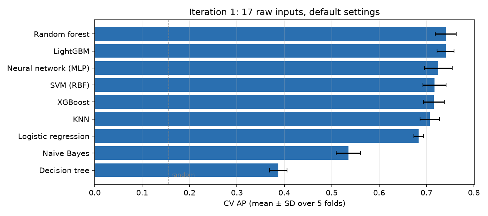
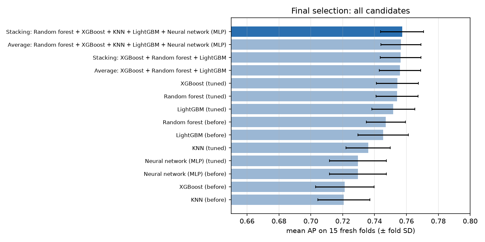
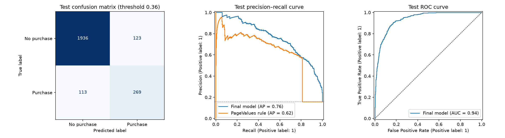
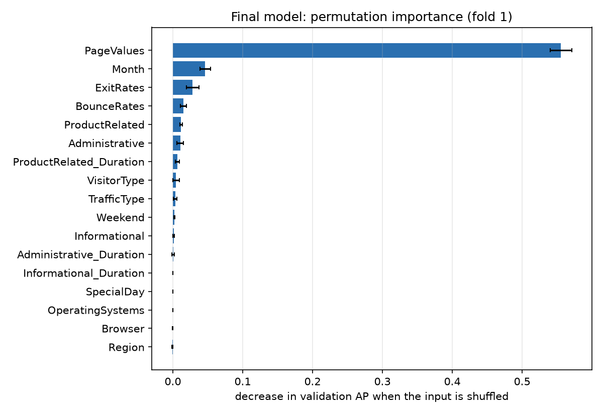

# Predicting Online Purchase Intention

**INSY 674 · Fall 2026 · Group Project**

> Can we predict, from browsing behaviour, whether an online shopping session ends in a purchase, and which behaviours matter most?

| | |
|---|---|
| **Team** | Group 3 |
| **Dataset** | [Online Shoppers Purchasing Intention](https://archive.ics.uci.edu/dataset/468/online+shoppers+purchasing+intention+dataset) (UCI, Sakar & Kastro, 2018, CC BY 4.0) |
| **Task** | Supervised binary classification (`Revenue`: 1 = purchase, 0 = no purchase) |
| **Primary metric** | Average precision (AP, area under the precision-recall curve) |
| **Final model** | Stacking ensemble of tuned Random Forest, XGBoost, KNN and LightGBM |

### Team members

| Name | GitHub ID | Main contribution |
|---|---|---|
| Yanjie Gu | [@YanjieGu20](https://github.com/YanjieGu20) | Naive Bayes, XGBoost, LightGBM |
| Yangyang Liu | [@xiaogouyy](https://github.com/xiaogouyy) | Model comparison, fine-tuning, ensembles |
| Yorkin Ma | [@Yorkinpp](https://github.com/Yorkinpp) | Logistic regression |
| Yidi Mo | [@hazelmok704-cloud](https://github.com/hazelmok704-cloud) | Technical documentation (README); results synthesis across notebooks |
| Eric Sun | [@Eric0730-04](https://github.com/Eric0730-04) | K-nearest neighbours, random forest |
| Vincent Wang | [@VincentWang35](https://github.com/VincentWang35) | EDA, feature engineering, train/test split |
| Weiwei Xu | [@weiweicathy](https://github.com/weiweicathy) | Business framing, objectives, and assumptions & limitations |

---

## Key results at a glance

- **Final model:** a stacking ensemble of four tuned models (random forest, XGBoost, KNN, LightGBM), combined by a logistic regression.
- **Final model test performance:** **AP 0.763** (95% CI: 0.722–0.804) and **ROC-AUC 0.938**. Although the final model was selected using cross-validation, the test set had also been evaluated in earlier individual-model experiments, so these results should be interpreted with caution.

- At the threshold chosen on training data (0.36), the model **finds 70% of buyers (269 of 382)**, and **69% of the sessions it flags actually buy**. It raises 123 false alarms, against 233 for the `PageValues` rule.
- **Cross-validation consistency:** The repeated cross-validation estimate (**AP 0.757 ± 0.013**, across 3 × 5 folds) is close to the reported test performance (**AP 0.763**). This agreement is encouraging, but it does not eliminate potential bias from earlier test-set exposure.
- **"`PageValues` is the number-one predictor of purchase; after it, the month and the exit rate matter most."** This holds for every model we trained.
- **Main caveat:** Model performance depends heavily on `PageValues`, which may contain information closely related to purchase outcomes. Removing this feature reduces cross-validation AP from **0.758 to 0.383**. Therefore, the reported performance should be interpreted as an **offline, whole-session benchmark**, rather than evidence of real-time prediction capability.

---

## Repository structure

```
.
├── README.md                                 ← this file
├── requirements.txt                          ← Python dependencies
├── train_raw.csv                             ← shared training split (9,764 sessions)
├── test_raw.csv                              ← shared held-out test split (2,441 sessions)
│
├── Online_Purchase_Intention_EDA 3.0.ipynb   ← 1. data understanding, EDA, feature engineering, split
├── session_preprocessing.py                  ←    helper module imported by the EDA notebook
│
├── logistic_regression.ipynb                 ← 2. individual model notebooks (one per team member)
├── naive Bayes.ipynb
├── knn_project.ipynb
├── random_forest_project.ipynb
├── XGboost.ipynb
├── LightGBM.ipynb
├── LR_README.md                              ←    notes for the LR notebook
├── logistic_regression_results/              ←    LR models, CV tables, plots, OOF predictions
├── knn_results/                              ←    KNN model, CV tables, plots
│
├── model_comparison.ipynb                    ← 3. all six models in one leak-free pipeline, error analysis, shortlist
├── model_comparison_results/                 ←    CV tables, importance, error overlap, shortlist.json
│
├── fine_tuning_models.ipynb                  ← 4. tuning, ensembles, final model, test evaluation
└── fine_tuning_results/                      ←    before/after tuning, ensemble selection, test results and CI
```

**Reading order:** EDA → individual model notebooks → `model_comparison.ipynb` → `fine_tuning_models.ipynb`. The last two notebooks hold the team's official comparison and final model; the individual notebooks document each member's own exploration of their model.

## How to run

```bash
git clone https://github.com/xiaogouyy/Predicting-Online-Purchase-Intention.git
cd Predicting-Online-Purchase-Intention
pip install -r requirements.txt
jupyter lab        # or open the notebooks in VS Code / Google Colab
```

- The modelling notebooks use `train_raw.csv` for training. Some individual-model notebooks also use `test_raw.csv` for exploratory evaluation, as acknowledged in Section 5.
- `model_comparison.ipynb` writes `model_comparison_results/shortlist.json`, which `fine_tuning_models.ipynb` reads, so run them in that order.
- `fine_tuning_models.ipynb` runs several random searches and takes about 25 minutes on a laptop.
- In the final modelling workflow, `fine_tuning_models.ipynb` performs the final test-set evaluation in a guarded cell at the end. Earlier test-set evaluations in individual-model notebooks are discussed in Section 5.

> **Note:** the EDA notebook needs the original UCI file and the helper module `session_preprocessing.py` (included in this repo). To re-run it, download the dataset from the [UCI page](https://archive.ics.uci.edu/dataset/468/online+shoppers+purchasing+intention+dataset) and save it as `data/raw/online_shoppers_intention.csv`. The notebook writes its outputs to `data/processed/`, `figures/` and `tables/`; the split it produces is the same as `train_raw.csv` / `test_raw.csv` in the repo root, which every modelling notebook uses. You do not need to re-run the EDA to run the modelling notebooks.
---

## 1. Frame the problem and look at the big picture

### Objective
Online retailers receive large volumes of website traffic, but only a small proportion of browsing sessions result in purchases. Our objective is to **predict whether an online shopping session will result in a purchase** and identify **which browsing behaviours are most predictive of conversion**.

By identifying sessions with higher purchase propensity, our models can support **customer behaviour analysis, segmentation, and marketing prioritisation**. For example, retailers can analyse the top 10% of sessions ranked by predicted purchase probability to better understand high-intent shopping behaviour.

Since the dataset contains complete-session information, this project focuses on **offline purchase prediction**, rather than real-time customer targeting. Real-time personalised offers would require additional data and validation.

### Who uses the solution and how
- **Marketing / CRM teams** can use the model's predictions to analyse high-purchase-intent sessions and inform future customer segmentation and marketing strategies. These insights may also support post-session retargeting and follow-up decisions.
- **E-commerce / product analysts** use the feature-importance results to understand what separates buyers from browsers.

### Current solutions
No incumbent model came with the data, so we compare against two reference points:
- **Majority-class baseline** (predict "no purchase" for everyone): 84.4% accuracy, but it finds **zero** buyers. AP = 0.156.
- **One-line rule "rank sessions by `PageValues`":** Test AP **0.622**. This serves as an **offline reference benchmark** for model comparison. However, because `PageValues` may contain information related to purchase outcomes, this benchmark does not establish whether a model is suitable for real-world deployment.

### Framing
- **Supervised** learning: every session is labelled with `Revenue`.
- **Binary classification**: purchase vs no purchase.
- **Offline / batch** training: the data are a fixed one-year snapshot of completed sessions, not a live event stream.

### Performance measure, and why it fits the objective
Only **15.6%** of sessions end in a purchase, so accuracy is misleading (the do-nothing baseline already scores 84%). We therefore use:
- **Average precision (AP)** as the primary metric. It measures how well the model ranks buyers above non-buyers, which is exactly what a "target the top X%" campaign needs. Random ranking gives AP = 0.156.
- **ROC-AUC** as a secondary ranking metric.
- **Precision, recall and F1** at a chosen threshold, because a campaign also needs a cut-off. Precision is the share of the outreach budget that reaches real buyers; recall is the share of buyers reached.

---

## 2. Explore the data

*(Notebook: `Online_Purchase_Intention_EDA 3.0.ipynb`)*

### Dataset overview
- **Dataset size:** **12,330 raw sessions**, with **17 input features** and **1 target** (`Revenue`). Each row represents an online shopping session, and the dataset covers one year.
- **No missing values**, no negative values, no out-of-range rates.
- **Duplicate removal:** **125 exact duplicate rows** (all non-purchases) were removed **before** the train/test split, leaving **12,205 sessions**. The removed rows were saved for audit.
- **January and April are missing** from the data; they were not filled in.
- **Purchase rate:** **15.47%** in the raw dataset (1,908 out of 12,330 sessions), increasing to **15.63%** after duplicate removal (1,908 out of 12,205 sessions). The target remains **imbalanced**.

To avoid peeking at the test set, the **train/test split was made before any target-based exploration**. All statistics and plots below use the training set only.

### Attribute profile

| Feature | Type | Missing | Distribution / noise | Usefulness | Preparation |
|---|---|---|---|---|---|
| `Administrative` | count | 0% | right-skewed, 46% zeros | moderate | log1p + scale |
| `Administrative_Duration` | continuous | 0% | right-skewed, zero-inflated; some pages have 0 recorded time | moderate | log1p + scale |
| `Informational` | count | 0% | 78% zeros | low | log1p + scale |
| `Informational_Duration` | continuous | 0% | 80% zeros, long tail | low | log1p + scale |
| `ProductRelated` | count | 0% | right-skewed (max 705) | moderate | log1p + scale |
| `ProductRelated_Duration` | continuous | 0% | long upper tail (max 63,974) | moderate | log1p + scale |
| `BounceRates` | rate [0, 0.2] | 0% | zero-heavy | moderate | scale |
| `ExitRates` | rate [0, 0.2] | 0% | right-skewed | **high** (ρ = −0.25) | scale |
| `PageValues` | continuous | 0% | zero-inflated, right-skewed | **very high** (ρ = +0.62), possible leakage | log1p + scale; tested with and without |
| `SpecialDay` | score [0, 1] | 0% | mostly zero | low | scale |
| `Month` | nominal (10 levels) | 0% | Nov and May dominate | **high** | one-hot |
| `OperatingSystems` | nominal code | 0% | some rare levels | low | one-hot |
| `Browser` | nominal code | 0% | many rare levels | low | one-hot |
| `Region` | nominal code | 0% | 9 levels | none (Cramér's V = 0) | one-hot |
| `TrafficType` | nominal code | 0% | 20 levels, many rare | moderate | one-hot |
| `VisitorType` | nominal (3 levels) | 0% | 86% returning | moderate | one-hot |
| `Weekend` | binary | 0% | 23% weekend | low | 0/1 |
| **`Revenue`** | **binary target** | 0% | 15.6% positive | target | — |

`OperatingSystems`, `Browser`, `Region` and `TrafficType` are stored as numbers but are **category labels** (traffic type 10 is not "twice" traffic type 5), so they are one-hot encoded, never treated as numbers.

### Key findings from the plots

| Finding | Takeaway |
|---|---|
| **Target balance:** 84.4% no purchase vs 15.6% purchase | Accuracy is not a useful metric; stratify the split; use AP. |
| **Buyers browse more:** median 29 product pages vs 16, and 1,123 vs 531 units of product-page time | Product engagement is a purchase signal (association, not cause). |
| **Buyers exit less:** median exit rate 0.016 vs 0.028 | `ExitRates` is the strongest browsing signal after `PageValues`. |
| **Seasonality:** November converts at **25.4%** vs **10.7%** in May | Keep `Month` as a categorical feature. |
| **New visitors convert more:** 24.1% vs 14.2% for returning visitors | Keep `VisitorType`. |
| **`PageValues`:** sessions with a positive value convert at **56.2%**, vs **3.9%** for zero | By far the strongest single signal, which raises the leakage question below. |
| **Rare categories:** several browser/traffic codes have < 50 sessions | Their conversion rates are unreliable; they are later grouped as "infrequent". |

### Correlations
- **Spearman correlation** with the target (used because features are skewed): `PageValues` +0.62, `ExitRates` −0.25, `ProductRelated_Duration` +0.21, `ProductRelated` +0.19.
- **Cramér's V** for categorical features: `Month` 0.17, `TrafficType` 0.17, `VisitorType` 0.09, `Region` 0.00.
- Page counts and their durations are strongly correlated with each other, and so are `BounceRates` and `ExitRates`. This **redundancy** matters for models that assume independent features (see naive Bayes below).

### The `PageValues` question
`PageValues` is the Google Analytics value credited to the pages a visitor saw before a transaction. If a session's value includes its **own** purchase, the feature leaks the answer. Evidence from the training data (`model_comparison.ipynb` §2):
- **It is not a copy of the outcome:** 19.5% of buyers have `PageValues = 0`, and 11.6% of non-buyers have a positive value. A value computed from the session's own purchase would be positive for every buyer.
- **Indirect leakage is still possible:** if the page values were computed over the same period, they include these sessions' purchases, which works like target encoding fitted on all the data.

**Team decision:** the main models **include** `PageValues`, and every model is also cross-validated **without** it as a sensitivity check (Section 4).

### Promising transformations and useful extra data
- **Transformations:** `log1p` on counts, durations and `PageValues` (long right tails), scaling for distance-based and linear models, one-hot encoding for categorical codes, grouping of rare category levels, and quantile binning for naive Bayes.
- **Extra data that would help:** add-to-cart and checkout events, product prices and promotions, customer purchase history, timestamps (for a time-based split), named traffic channels and campaign costs, and a user ID to group repeat visits.

---

## 3. Prepare the data, then measure and compare models

*(Notebook: `model_comparison.ipynb`, which reads the training set only)*

### Train/test split
- **Stratified 80/20 split**, `random_state=42`, made once in the EDA notebook and saved as `train_raw.csv` / `test_raw.csv`.
- Training: **9,764** sessions (15.63% purchases). Test: **2,441** sessions (15.65% purchases).
- **Test-set handling:** In the final modelling workflow, model selection, hyperparameter tuning, ensemble selection and threshold optimisation were conducted using cross-validation on the training data. However, some individual-model notebooks and earlier experiments also evaluated the test set. Therefore, the reported test performance may be optimistic and should be interpreted with caution.

### Leak-free preprocessing pipeline
All learned steps sit inside one scikit-learn `Pipeline`, so they are **refitted on the training part of each CV fold** and never see the validation or test rows.

| Step | What is done | Why |
|---|---|---|
| Cleaning | No missing values, so nothing is imputed. Codes are treated as nominal labels. | A value like `TrafficType = 10` is a label, not an amount. |
| Feature engineering (optional) | 12 row-level features: totals, average time per page, product shares, zero-activity flags. | They describe browsing depth and focus more directly. |
| Rare categories (optional) | Levels below 1% of the training fold are merged into "infrequent". | Avoids noisy estimates for rare browsers and traffic types. |
| Encoding | One-hot; unseen levels at prediction time are ignored or mapped to "infrequent". | Most models need numeric inputs. |
| Scaling (KNN, logistic regression) | `log1p` on counts, durations and `PageValues`, then a scaler. | Long right tails and many zeros; these models are scale-sensitive. |
| Binning (naive Bayes) | 10 quantile bins per continuous column. | The inputs are far from normal; bins need no distribution assumption. |
| Tree models | No scaling. | Splits depend only on the order of values. |

### Iteration 1: six models, five families, one shared pipeline
Every model uses **5-fold stratified CV** (`StratifiedKFold(5, shuffle=True, random_state=42)`) with default settings, so they are compared on equal terms. Results are **mean ± SD over the 5 folds**.

| Model | Family | CV AP | CV ROC-AUC | Train AP |
|---|---|---|---|---|
| Random forest | bagged trees | **0.740 ± 0.022** | 0.923 | 1.000 |
| LightGBM | boosted trees | **0.740 ± 0.018** | 0.927 | 0.967 |
| XGBoost | boosted trees | 0.716 ± 0.022 | 0.919 | 0.996 |
| KNN (k = 25) | instance-based | 0.707 ± 0.021 | 0.907 | 1.000 |
| Logistic regression | linear | 0.684 ± 0.010 | 0.913 | 0.696 |
| Naive Bayes (binned) | probabilistic | 0.535 ± 0.026 | 0.870 | 0.538 |
| Baseline (purchase rate) | — | 0.156 | 0.500 | — |

- Random forest, KNN and XGBoost reach a **train AP of about 1.0**: they memorise the training data at default settings, so they should gain from regularisation.
- Logistic regression and naive Bayes have similar train and CV AP: they **underfit**; their model form is the limit.
- Fold SDs are about 0.02, so gaps smaller than that are not meaningful.



*All six models beat random ranking (dashed line, AP 0.156); the tree ensembles lead.*

### Most significant variables
Permutation importance (drop in AP when one input is shuffled), averaged over the 5 validation folds:

| Input | LR | NB | KNN | RF | XGBoost | LightGBM |
|---|---|---|---|---|---|---|
| `PageValues` | 0.470 | 0.265 | 0.506 | 0.521 | 0.521 | 0.544 |
| `Month` | 0.029 | 0.015 | 0.021 | 0.038 | 0.047 | 0.051 |
| `ExitRates` | 0.012 | 0.015 | 0.013 | 0.029 | 0.047 | 0.045 |
| `BounceRates` | 0.004 | 0.010 | 0.005 | 0.020 | 0.028 | 0.021 |

- `PageValues`, `Month` and `ExitRates` are the top three for **every** model.
- `Region`, `OperatingSystems`, `Browser` and `Informational_Duration` have importance ≤ 0.003 for almost every model: mostly noise.
- **Naive Bayes has negative importance for all six page-count and duration inputs**, because it treats correlated inputs as independent evidence and counts them twice.

### Error analysis
At each model's max-F1 threshold on out-of-fold predictions:

| Error type | What it looks like | Data a human would use to avoid it |
|---|---|---|
| **Missed buyers** (390–480 per model) | 56–70% have `PageValues = 0` (vs 20% of all buyers); often in November. Typically a returning customer who goes straight to checkout. | Add-to-cart and checkout events, purchase history, coupon codes |
| **False alarms** (600–770 per model) | Heavy browsers (≈ 40 product pages vs 16 for typical non-buyers) with high `PageValues`; 86–94% are returning visitors. Typically comparison shoppers. | Cart abandonment step, prices and stock, shipping-cost and return-policy page visits |
| **Errors shared by all six models** (540 sessions) | Sessions whose recorded behaviour looks the same for buyers and non-buyers. | User identity and the order of clicks within the session |

The models largely make the **same** errors: random forest and LightGBM share 70% of theirs, and pairwise error overlaps are 0.52–0.70 (Jaccard). XGBoost and KNN overlap least, which makes them good ensemble partners.

### Iterations 2 and 3: feature engineering and feature selection

| Model | 1. Raw | 2. + 12 engineered | 3. Per-model selection | Best configuration |
|---|---|---|---|---|
| Random forest | 0.740 | 0.731 | **0.745** | selection + rare grouping |
| LightGBM | 0.740 | **0.740** | 0.739 | + engineered |
| XGBoost | 0.716 | 0.719 | **0.724** | selection |
| KNN | 0.707 | 0.700 | **0.723** | selection + rare grouping |
| Logistic regression | 0.684 | 0.682 | **0.685** | selection |
| Naive Bayes | 0.535 | 0.445 | **0.660** | selection |

- **Feature engineering did not help:** changes of −0.009 to +0.003 for the stronger models. The engineered totals and averages repeat information the models already have.
- **Feature selection helped:** dropping inputs with importance ≤ 0 raised KNN by +0.017, XGBoost by +0.008, random forest by +0.005, and **naive Bayes by +0.124**, because removing the correlated page inputs ends its double counting.

### Shortlist: random forest, XGBoost, KNN, LightGBM
**Rule (fixed before reading the results):** keep every model within one fold SD of the best, then add them in order of **least error overlap** with those already chosen.

| Model | CV AP | Why it is on the list |
|---|---|---|
| **Random forest** | 0.745 ± 0.024 | Best model; precision-oriented errors; overfits at defaults, so it has room to improve. |
| **XGBoost** | 0.724 ± 0.024 | Lowest error overlap with the random forest; clearly overfits at defaults. |
| **KNN** | 0.723 ± 0.027 | A different family; judges sessions by similar sessions, not by splits. |
| **LightGBM** | 0.740 ± 0.025 | Second-best score; recall-oriented errors. |

**Not shortlisted:** logistic regression (0.685) and naive Bayes (0.660) are 0.06–0.09 AP behind, a structural gap from their model forms. Without `PageValues`, logistic regression would overtake KNN.

---

## 4. Fine-tune the system

*(Notebook: `fine_tuning_models.ipynb`)*

### Search method
- **Random search for every model** (60–80 candidates each), because each search space has 8–13 hyperparameters with thousands to millions of combinations. Random search tries more distinct values of the important parameters than a grid (Bergstra & Bengio, 2012).
- **Data-transformation choices were tuned as hyperparameters:** input selection, engineered features, rare-category grouping, one-hot vs ordinal encoding, and for KNN the scaler, log transform and category weight.
- **No Bayesian optimisation:** one 5-fold evaluation takes seconds, and random search runs candidates in parallel.
- For XGBoost and LightGBM, the number of trees was read from each candidate's validation curve.
- **The tuned settings were confirmed on 15 fresh folds** (3 × 5-fold, seed 2026) that played no part in tuning, because the winner of a search is optimistic on the folds it was chosen on.

### Tuning results (15 fresh folds)

| Model | AP before → after | Folds improved | What changed |
|---|---|---|---|
| **XGBoost** | 0.721 → **0.754** (+0.033) | 15/15 | Defaults overfit after ~10 trees. Learning rate 0.02 with 175 trees, `min_child_weight` 9, `gamma` 2.2, 80% row sampling. |
| **KNN** | 0.721 → **0.736** (+0.015) | 15/15 | k 25 → 65, uniform votes, Manhattan distance, RobustScaler, category block down-weighted to 0.5. |
| **Random forest** | 0.747 → **0.754** (+0.007) | 14/15 | Leaves of ≥ 20 sessions, `max_features` 0.3, 60% bootstrap samples, depth 10. Train AP 1.0 → 0.81. |
| **LightGBM** | 0.745 → **0.752** (+0.006) | 11/15 | ≥ 100 sessions per leaf, `min_split_gain` 0.48, L1 penalty 2.6, learning rate 0.01 with 350 trees. |

*Note: The "before" AP values in this table were evaluated on 15 fresh cross-validation folds, while the shortlist scores were reported in the earlier model comparison stage. Therefore, small differences may occur (e.g., XGBoost: 0.724 vs. 0.721).*

Tuning mostly **reduced overfitting**. All four tuned models **dropped the engineered features**, and all three tree models chose rare-category grouping.


### Ensembles (15 fresh folds)

| Candidate | AP |
|---|---|
| **Stacking of all four tuned models** | **0.757 ± 0.013** |
| Soft-voting average of all four | 0.756 ± 0.013 |
| Stacking of the three tree models | 0.756 |
| Averaging of the three tree models | 0.756 |
| Tuned XGBoost (best single model) | 0.754 ± 0.013 |
| Tuned random forest | 0.754 |

**Selection rule (fixed in advance):** take the highest mean AP unless a simpler candidate is within one standard error of the paired difference. Stacking of all four won.

The gain over the best single model is small (+0.003) because the tuned models' scores are highly correlated (Spearman 0.88–0.98). KNN, the least correlated member, is what lifts the four-model ensembles above the tree-only ones.



*Tuning lifted every shortlisted model; stacking all four tuned models scored highest, slightly ahead of tuned XGBoost.*

### Final model: stacking ensemble
A logistic regression combines the four tuned models' probabilities. It was refitted on all 9,764 training sessions, and the decision threshold (**0.36**, max F1 on out-of-fold predictions) was fixed before the test set was read.

| Member | Stacking weight |
|---|---|
| XGBoost | 4.25 |
| Random forest | 1.52 |
| KNN | 1.16 |
| LightGBM | −0.19 (duplicates XGBoost; score correlation 0.98) |

### Final model test-set evaluation

| Model | AP | ROC-AUC | Precision | Recall | F1 | False alarms |
|---|---|---|---|---|---|---|
| Baseline (purchase rate) | 0.156 | 0.500 | 0.000 | 0.000 | 0.000 | 0 |
| Rule: rank by `PageValues` | 0.622 | 0.866 | 0.571 | **0.812** | 0.670 | 233 |
| **Final stacking ensemble** (threshold 0.36) | **0.763** | **0.938** | **0.686** | 0.704 | **0.695** | **123** |

| | Predicted no purchase | Predicted purchase |
|---|---|---|
| **Actual no purchase** | 1,936 | 123 |
| **Actual purchase** | 113 | **269** |



*On the held-out test set, the model (AP 0.76) beats the PageValues rule (AP 0.62) at almost every recall level.*

- **Test AP 0.763 (95% bootstrap CI: 0.722–0.804)** is close to the repeated cross-validation estimate of **0.757 ± 0.013**. This agreement is encouraging, but the reported test performance should be interpreted cautiously because the test set was also evaluated in earlier experiments.
- Compared with the `PageValues` rule, the model adds **+0.14 AP** and **halves the false alarms** (123 vs 233), at the cost of finding fewer buyers (70% vs 81%).
- At a 0.5 threshold instead: precision 0.72, recall 0.66, F1 0.69. The right threshold depends on the cost of an offer versus the value of a sale.

### What drives the final model
Permutation importance on a training validation fold: **`PageValues` 0.556**, `Month` 0.046, `ExitRates` 0.030, `BounceRates` 0.016, then product and administrative page counts. Region, browser, operating system and weekend contribute almost nothing.



*PageValues is the number-one predictor of purchase; month and exit rate come next.*

### Sensitivity check: without `PageValues`

| Model (same settings, CV) | AP with `PageValues` | AP without |
|---|---|---|
| **Final stacking ensemble** | 0.758 | **0.383** |
| Random forest | 0.740 | 0.370 |
| LightGBM | 0.740 | 0.362 |
| XGBoost | 0.716 | 0.344 |
| Logistic regression | 0.684 | 0.339 |
| KNN | 0.707 | 0.318 |
| Naive Bayes | 0.535 | 0.312 |

*(Individual models at iteration-1 settings, from `model_comparison.ipynb` §2.)*

*Note: The stacking AP of 0.758 reported in this sensitivity analysis is separate from the main repeated cross-validation estimate of 0.757 ± 0.013. Both values are cross-validation results, not test-set scores.*

 Without `PageValues`, the final model is still **2.5× better than random**, but half of its performance rests on this one variable. The no-`PageValues` figure is the most conservative estimate of what browsing behaviour alone can predict.

---

## 5. Assumptions and limitations

| Assumption or limitation | Likely impact | How to address it |
|---|---|---|
| **`PageValues` is available at prediction time and free of leakage.** It is not a copy of the outcome, but the page values were probably computed over the same period. | If it leaks, performance is overstated by about 2× (AP 0.76 vs 0.38). | Ask the data owner how and over which window page values were computed; rebuild them from an earlier period only; report the no-`PageValues` model as a lower bound. |
| **The test set is not fully fresh.** Individual-model notebooks and earlier versions of the fine-tuning notebook also evaluated it. | Earlier test-set exposure may introduce optimistic bias into the reported performance. The similarity between CV (0.757) and test AP (0.763) does not establish the size of this potential bias. | Treat cross-validation as the primary performance estimate and validate the final model on genuinely unseen future sessions. |
| **Sessions are independent and representative of future traffic** (random split of one year; Jan and Apr missing). | Repeat visitors may appear in both splits, and seasonal patterns can shift, so future performance may be lower. | Validate by time (train on earlier months, test on later ones) and by user once IDs exist. |
| **Features describe the complete session.** | The model can only score a session after it ends, so it cannot yet trigger an intervention during a visit. | Rebuild features from partial sessions (first n pages or minutes) using clickstream data. |
| **The threshold maximises F1, not profit.** | Missed buyers and false alarms may not match the business optimum. | Set the threshold from the value of a purchase and the cost of an offer. |
| **The ensemble is complex for a small gain** (+0.003 AP over tuned XGBoost). | Four models are harder to maintain, explain and monitor than one. | If simplicity matters more, use tuned XGBoost or the averaging ensemble. |
| **Missing information explains many errors** (cart events, prices, customer history). | 540 sessions are misclassified by all six models; no tuning can fix them. | Collect the event-level data listed in the error analysis. |
| **Duplicate removal.** 125 identical rows were treated as duplicates. | Tiny change in conversion rate (15.47% → 15.63%). | Sensitivity analysis with duplicates kept. |
| **Prediction is not causation.** | High-intent users may buy anyway, so targeting them may not add sales. | Run a randomised campaign or uplift model before deployment. |

---

## 6. What worked and what did not

**Worked**
- **Data splitting and cross-validation pipelines** reduced the risk of preprocessing leakage by fitting data transformations within the training portion of each CV fold. However, potential leakage associated with `PageValues` remains a limitation.
- Using **AP instead of accuracy**: accuracy would have ranked a do-nothing model at 84%.
- **Comparing all six models in one shared pipeline**, so differences reflect the models, not each notebook's own preprocessing.
- **Per-model feature selection**, especially for naive Bayes (+0.124 AP) and KNN (+0.017).
- **Regularised tuning**: XGBoost gained +0.033 AP once its learning rate and minimum leaf size were controlled.
- **Confirming on 15 fresh folds** before choosing the final model, so selection was not driven by the tuning folds.

**Did not work**
- **Engineered features** never improved any model beyond fold noise, and all tuned models dropped them.
- **`log1p` for Gaussian naive Bayes** made it worse, because the large spike at zero is still not normal.
- **Class weighting** shifts probabilities but barely changes the ranking (AP).
- **Ensembling gave only a small gain** (+0.003), because the strong models make largely the same errors.

---

## References
1. Sakar, C. O., Polat, S. O., Katircioglu, M., & Kastro, Y. (2019). Real-time prediction of online shoppers' purchasing intention using multilayer perceptron and LSTM recurrent neural networks. *Neural Computing and Applications*, 31, 6893–6908.
2. Sakar, C. & Kastro, Y. (2018). *Online Shoppers Purchasing Intention Dataset*. UCI Machine Learning Repository. https://doi.org/10.24432/C5F88Q
3. Bergstra, J., & Bengio, Y. (2012). Random search for hyper-parameter optimization. *Journal of Machine Learning Research*, 13, 281–305.
4. Géron, A. (2019). *Hands-On Machine Learning with Scikit-Learn, Keras, and TensorFlow* (2nd ed.), Appendix B: Machine Learning Project Checklist. O'Reilly.
